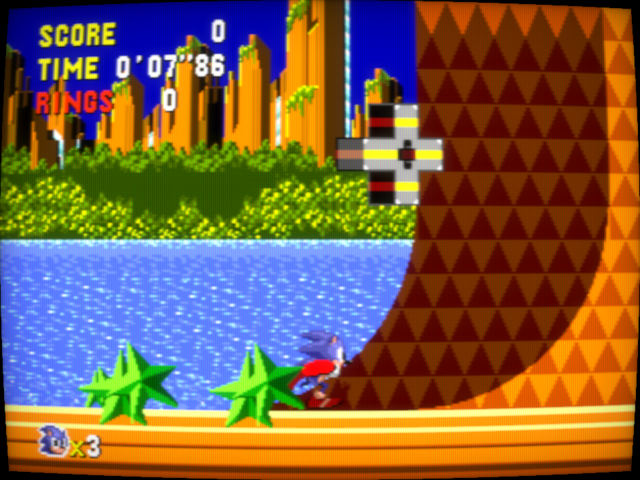
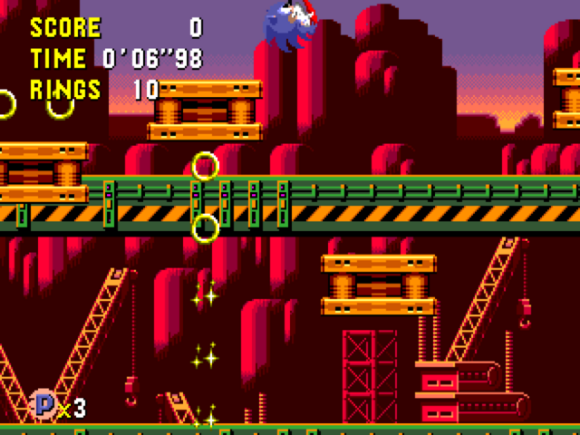
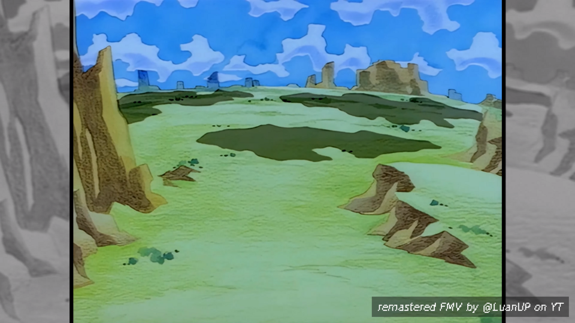
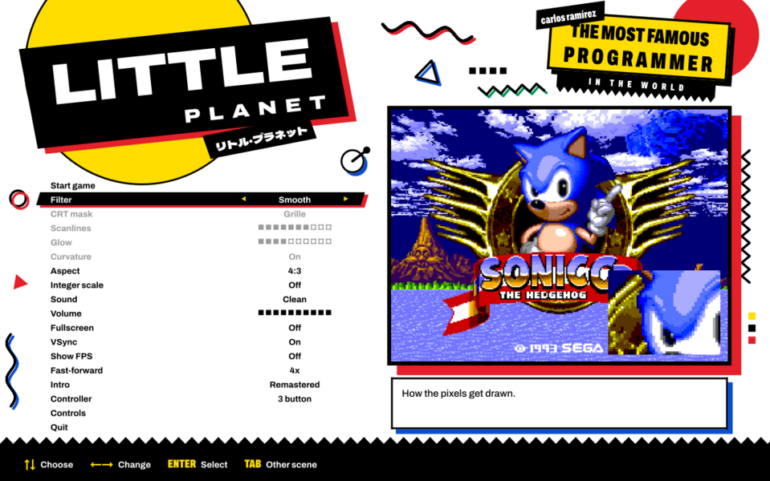
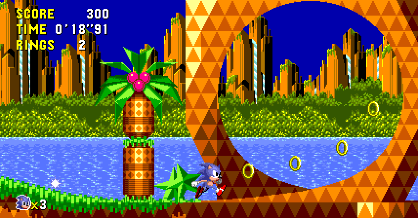

<p align="center"></p>

<h1 align="center">Little Planet</h1>

<p align="center">
<b> Sonic CD (Mega-CD) decomp / PC port, built for fidelity </b>
<br>
Windows, macOS and Linux.
</p>

<p align="center">
<a href="https://github.com/carlosrmz009/littleplanet/actions/workflows/build.yml"></a>
<a href="https://github.com/carlosrmz009/littleplanet/releases/latest"></a>
</p>

---

* **Runtime.** Both 68000s, the Z80, VDP, YM2612, PSG, RF5C164 PCM, the CD drive and decoder, CD audio and the
  Mega-CD graphics ASIC, written from scratch (YM2612 via [ymfm](https://github.com/aaronsgiles/ymfm)). No BIOS
  needed: the boot ROM and sub-CPU BIOS are replaced by a high-level implementation of the calls the game makes.
* **Decomp.** A disassembly of all the game's code that reassembles byte-identical to the disc, and a static
  recompiler that turns it into C, which is what runs (checked frame by frame against the interpreter).
* **Remastered opening.** [LuanUP](https://www.youtube.com/@LuanUP)'s 4K 60 fps remaster in place of the FMV,
  synced to the game; the original is one setting away.
* **True widescreen.** The stages drawn 16:9, showing more of the level instead of stretching it.
* **Any disc image.** cue/bin (split or single), cue with wav/flac/ogg/mp3 audio, iso, ccd/img/sub and chd.
* **Launcher.** Dressed like the 90s Japanese Sonic boxes. CRT filters, aspect options, pad support, save states.

<p align="center">


<br>


</p>

> [!IMPORTANT]
> No game data is included. You need your own Sonic CD disc image. The Japanese release
> (G-6021, data track SHA-1 `5b0ac16233028bcd8691c71b0a749b8d485dae7c`) is the tested one; other releases
> boot but are untested.

## Play

Grab the file for your system from the [latest release](https://github.com/carlosrmz009/littleplanet/releases/latest):

| System | File | |
|---|---|---|
| Windows (x64) | `littleplanet.exe` | Run it to install. |
| macOS 11+ (Apple Silicon / Intel) | `littleplanet-macos.dmg` | Open it and run Little Planet. Not notarized: the first time, right-click → Open (macOS 15: System Settings → Privacy & Security → Open Anyway). |
| Linux x86_64 | `littleplanet-linux.AppImage` | `chmod +x` it and run it. |
| Linux ARM64 | `littleplanet-linux-aarch64.AppImage` | Same. |

The installer adds shortcuts, then asks for your disc image once and copies it (the .cue and everything it
points to, or the .chd/.iso/.ccd) into the data folder:

| | |
|---|---|
| Windows | `%APPDATA%\Little Planet` |
| macOS | `~/Library/Application Support/Little Planet` |
| Linux | `~/.local/share/littleplanet` |

Saves (the Mega-CD's backup RAM) go to `backup_ram.bin` there. Uninstalling keeps that folder.

### Fidelity

* CD audio is streamed bit-exact from the disc and resampled to 48 kHz with a windowed-sinc filter.
  FM, PSG and PCM are each resampled the same way from their native rates (53.3 kHz, 223.7 kHz, 32.6 kHz).
* The CD drive reads at 1x with seek times, like the real thing: load times and the FMV streaming are as on hardware.
* Colours use measured VDP DAC levels, including shadow/highlight. Sprite limits, masking and the
  attribute cache behave like the hardware.
* The CPU cores are checked against the [SingleStepTests](https://github.com/SingleStepTests) suites:
  the Z80 passes all 1.6M cases (undocumented flags, WZ, Q, timing), the 68000 all of the 1M cases
  apart from a few undocumented DIVS/ASR corner cases and address errors.

### Remastered opening


The opening animation is [LuanUP](https://www.youtube.com/@LuanUP)'s
[4K 60 fps remaster](https://www.youtube.com/watch?v=O7ehCx2RC2A) of the Japanese opening, shown full screen (16:9)
in place of the original FMV, with a credit on screen as it starts. It ships with the game. (Thanks, LuanUP!)
Besides the title screen's attract loop, it also plays every time you start a new game; Start skips it.

**Setup → Intro → Original** brings back the game's own opening. Playback uses a small
LGPL build of [FFmpeg](https://ffmpeg.org) that ships with the game.

### Widescreen



**Setup → Aspect → 16:9 widescreen** draws the stages 428 pixels wide instead of 320: 16:9 with the Mega
Drive's pixel shape, like the 2011 version, without stretching anything. The game still plays on its own
320-pixel screen; the stage engine is patched in a handful of places (the same ones in each of the 73 files
that carry it, found by tools/wide_gen.py) to draw the level and show objects further out, and the picture
reaches past either side of that screen, never past where the camera can go. The HUD sits at the left edge,
as in the 2011 version; title cards stay in the middle. Objects at the sides count as on screen, so badniks
there wake up a little earlier than on a TV. Menus, special stages and cutscenes stay 4:3. Switched on in the
middle of an act, it starts at the next one.

### Extras

The setup menu has a live preview. Esc, Home or Select+Start opens it in game.

| Option | |
|---|---|
| Filter | Sharp, Smooth, Scale4x, or CRT (grille/shadow/slot mask, scanlines, glow, curvature) |
| Aspect | 4:3 (as on a TV), square pixels, 16:9 fill (blurred sides), 16:9 widescreen (see below) |
| Sound | Clean, or Accurate: adds the Model 1 Mega Drive's low-pass on FM and PSG (CD audio is never filtered) |
| Intro | Remastered (LuanUP's 4K remaster, see above) or Original (the game's FMV) |
| Controller | 3 button (default, what Sonic CD was made for) or 6 button (the real 6-button protocol) |
| Misc | Integer scaling, fullscreen, VSync, FPS counter, volume, fast-forward speed |

### Controls

Remap anything under *Controls*. Xbox pads, DualShock 4 / DualSense, Switch Pro (Bluetooth) and most USB pads work, hot-plugged.

| Key | Pad | | Key | Action |
|---|---|---|---|---|
| Arrows | D-pad | | Tab | Fast-forward (hold) |
| Z / X / C | A / B / C | | F2 / F4 | Save / load state |
| Enter | Start | | F3 | Next state slot |
| A / S / D | X / Y / Z (6 button) | | P | Pause |
| Right Shift | Mode (6 button) | | F11, Alt+Enter | Fullscreen |
| | | | F12 | Screenshot |

## Build

**Windows:** Python 3.10+, Visual Studio 2022 Build Tools (MSVC x64).
**macOS:** Python 3, Xcode command line tools, SDL2.
**Linux:** Python 3, gcc/g++, SDL2. Packaging the AppImage also needs `appimagetool`.

For the remastered opening, build FFmpeg once with `tools/build_ffmpeg.sh build/ffmpeg` (needs nasm; on Windows run it
from an MSYS2 MINGW64 shell) and fetch the video with `tools/fetch_intro.sh`. The build scripts pick both up from
`build/` and bundle them; without them the game builds and runs the same, with only the original opening.

```bash
./build_linux.sh      # or ./build_mac.sh, or build.bat
build/littleplanet path/to/sonic.cue
```

### Matching build

```bash
tools/decomp.sh path/to/sonic.cue     # extract, reassemble asm/, compare with the disc
```

`asm/` is a disassembly of every executable file on the disc (boot program, main-CPU MMDs, sub-CPU programs): code
only, seeded from runtime coverage (`--cov`) and followed by recursive descent. Graphics, sound and level data stay
on your disc and are pulled in at build time. All 112 files reassemble byte-identical to the Japanese release.

The build also recompiles `asm/` to C (no disc needed for that) and links it into the game.
`tests/rc_check.sh path/to/sonic.cue` checks it against the interpreter over 96 stage runs.

CI ([build.yml](.github/workflows/build.yml)) builds all four targets and tests them against a tiny homebrew
test disc (`tools/mktestdisc.py`). Every push to `main` refreshes the release.

<details>
<summary>Command-line options</summary>

| Option | |
|---|---|
| `--frames N` | run headless for N frames |
| `--script FILE` | headless input: lines of `frame hexmask` (held from that frame on; bits: U D L R B C A Start) |
| `--shot a,b,c` / `--shotprefix P` | save BMP screenshots at those frames |
| `--wav FILE` | record audio (headless) |
| `--hashlog FILE` | per-frame hash of main and PRG-RAM, to compare runs |
| `--state FILE` / `--savestate FILE` | load a state before / save one after a headless run |
| `--dump PREFIX` | write RAM and VRAM at the end |
| `--uitest PREFIX` | scripted walk through the launcher and game, saving the real OpenGL output |
| `--apptest PREFIX` | the app straight into the game (after `--state`), window screenshots at the `--shot` frames, the sound in `PREFIX.wav`, quits after `--frames` |
| `--movie-check` | say whether FFmpeg (for the remastered opening) can be loaded |
| `--interp` | run the game's code through the interpreter instead of the recompiled C |
| `--rcstats` / `--rc-info` | how much ran recompiled and where the rest was / whether the recompiled code is built in |
| `--version` | print the version |

`tools/disctool` (built from `tools/disctool.c`) lists, hashes and extracts disc images.

</details>

## How it works

1. **Disc.** `src/disc.c` turns any image format into one view: data sectors by LBA, audio sectors by LBA,
   and the TOC. Track 1 index 01 is LBA 0, as the drive sees it.
2. **Boot.** `src/hle.c` does what the boot ROM does: loads the IP into main RAM and the SP into PRG-RAM, sets up
   both CPUs' vector and jump tables, and enters the game's code. BIOS entry points are tiny stubs whose
   line-A opcode traps into C.
3. **CD.** `src/cdc.c` is the drive (seek, 1x read, CD-DA play) plus the decoder's buffer and the gate array's
   transfer registers, so the game's own file engine runs unmodified.
4. **Machine.** `src/mcd.c` schedules everything on the 53.69 MHz master clock: main 68000 at /7, Z80 at /15,
   the sub 68000 on its own 12.5 MHz clock, the VDP per line.
5. **Recompiled code.** `tools/recomp.py` turns the code in `asm/` into C: each distinct instruction becomes a
   function calling the interpreter's own handler for its opcode with the operands compiled in, and straight-line
   runs become blocks (622k instructions in 112 files come down to 22,897 blocks, since the stages share their
   engine). `src/recomp.c` runs a block where memory holds the code it was compiled from (each instruction checks
   its own words, the ones the interpreter would fetch), and interprets anything else, such as the BIOS
   stand-ins. Blocks stop where the interpreter would let something else happen (cycle budget, interrupts,
   trace, exceptions), so the two produce the same machine state frame for frame: `tests/rc_check.sh` plays
   96 stage runs both ways and compares every frame.

## Status

| | |
|---|---|
| Boot, title, opening FMV, gameplay | yes |
| CD audio, PCM music, FM/PSG | yes |
| Save states | yes, bit-exact |
| Disassembly, matching rebuild | yes: all 112 executable files reassemble byte-identical |
| Static recompiler | yes: all game code runs as recompiled C, frame-identical to the interpreter |
| Remastered opening (4K60, synced) | yes |

## Contributing

Issues and PRs welcome. Never commit disc images.

## Layout

```
src/
  m68k.c m68k_ops.h  68000 (ops shared with future recompiled code)
  z80cpu.c z80.c     Z80 and its bus
  vdp.c              VDP
  audio.c fm.cpp     PSG, RF5C164, CD-DA, mixing; YM2612 through ymfm
  resample.c         band-limited resampler
  mcd.c              memory maps, gate array, scheduler
  cdc.c hle.c        CD drive/decoder, HLE BIOS
  asic.c             Mega-CD graphics ASIC
  disc.c version.c   disc images, known releases
  movie.c intro.c    remastered opening: FFmpeg playback, synced to the CD drive
  wide.c             widescreen: the stage engine's patches, the picture's edges
  recomp.c           runs the recompiled game code (generated from asm/ at build time)
  app.c ui.c video.c config.c discwiz.c update.c state.c
  ui_art.c vg.c gfx.c launcher art, its vector renderer (text via stb_truetype), installer widgets
  win32.c input.c    Windows front end
  sdl/ mac/ linux/   SDL front end, platform installers
installer/           Windows installer (littleplanet.exe)
third_party/         libchdr, ymfm, dr_mp3, stb_vorbis, stb_truetype
res/fonts/           the launcher's fonts (OFL)
tests/               CPU test-suite runners, pad protocol test, recompiler check (stages/: input scripts)
asm/                 disassembly of every executable file on the disc (code only; data comes from your disc)
tools/               disctool, disassembler/assembler, recompiler, widescreen patch finder, test disc generator,
                     FFmpeg build
```

## Thanks

* Sega and Sonic Team for Sonic CD.
* [ymfm](https://github.com/aaronsgiles/ymfm), [libchdr](https://github.com/rtissera/libchdr),
  [dr_libs](https://github.com/mackron/dr_libs), [stb](https://github.com/nothings/stb),
  [SDL2](https://www.libsdl.org/).
* [Archivo](https://github.com/Omnibus-Type/Archivo) and [Dela Gothic One](https://github.com/syakuzen/DelaGothic)
  (SIL Open Font License), the launcher's type.
* [SingleStepTests](https://github.com/SingleStepTests) for the CPU test suites.
* [LuanUP](https://www.youtube.com/@LuanUP) for the remastered opening.
* [FFmpeg](https://ffmpeg.org) (LGPL 2.1), which plays it.

## License

[MIT](LICENSE) for the runtime, tools and installer. Third-party code keeps its own license (see `third_party/`);
the bundled FFmpeg libraries are LGPL 2.1 (`tools/build_ffmpeg.sh` builds them from the unmodified release).
The remastered opening is LuanUP's work, included with their permission; it isn't covered by the MIT license.
Nothing extracted from a disc is covered.

Not affiliated with or endorsed by Sega. Sonic the Hedgehog and Sonic CD are trademarks of Sega.
